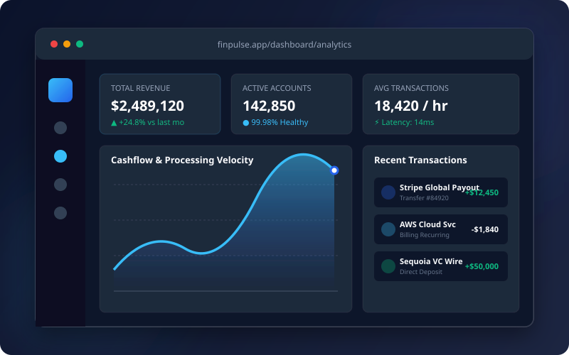

# Nexa Agency — Modern Digital Solutions

A modern, multi-page software agency website engineered with HTML5, CSS3, JavaScript, and Bootstrap 5.



---

## 🚀 Features & Overview

- **5 Complete Production-Ready Pages**:
  1. **Home (`index.html`)**: Hero section with *"We Build Modern Digital Solutions"*, dual CTAs, live tech partner marquee, animated statistics counters (250+ projects, 99% satisfaction, etc.), service highlights, featured case studies, client testimonials, and CTA banner.
  2. **About (`about.html`)**: Company founding story, evolutionary timeline milestones, mission and vision statements, 6 executive team profiles with custom avatar artwork, and a *"Why Choose Nexa"* comparative matrix.
  3. **Services (`services.html`)**: Deep-dive into 5 core capabilities (*Web Development, Front-End Development, UI/UX Design, E-Commerce Solutions, Website Maintenance*), 5-step delivery process, 3 flexible engagement models / pricing tiers, and an interactive FAQ accordion.
  4. **Portfolio (`portfolio.html`)**: 6 mock projects with SVG illustrations, category filter tabs (*All, Web Development, E-Commerce, UI/UX Design, SaaS & Cloud*), and an interactive Bootstrap case study detail modal.
  5. **Contact (`contact.html`)**: Interactive contact form with HTML5 validation and success alerts, direct channels (*Email, Phone, SF HQ Address, Hours*), interactive coordinate map preview card, and social media links.

- **Design System & Extra Features**:
  - **Curated Blue & White Palette**: Vibrant royal blue (`#2563eb`), sky cyan accents (`#38bdf8`), crisp white, and deep navy slate (`#0f172a`).
  - **Dark Mode Toggle**: Persistent dark/light theme switch saved in `localStorage`.
  - **Sticky Glassmorphism Navbar**: Frosted glass blur with scroll detection and mobile offcanvas menu.
  - **Scroll Reveal Animations**: Smooth `IntersectionObserver` element entrance animations.
  - **Back to Top Button**: Floating quick return button with scroll threshold awareness.
  - **100% Responsive**: Tailored for mobile phones, tablets, and 4K desktop screens.

---

## 📁 Project Structure

```
nexa-agency/
├── index.html              # Home Page
├── about.html              # About Page
├── services.html           # Services Page
├── portfolio.html          # Portfolio Page
├── contact.html            # Contact Page
├── README.md               # Documentation
├── css/
│   └── style.css           # Custom design system tokens, animations & components
├── js/
│   └── main.js             # Theme switcher, scroll observer, counters & filters
└── assets/
    ├── favicon.svg         # Modern vector brand favicon
    └── images/             # Crisp vector mockups & team avatars
        ├── project-finpulse.svg
        ├── project-auraluxe.svg
        ├── project-novahealth.svg
        ├── project-omnimetrics.svg
        ├── project-zenith.svg
        ├── project-hypercart.svg
        ├── team-1.svg
        ├── team-2.svg
        ├── team-3.svg
        ├── team-4.svg
        ├── team-5.svg
        └── team-6.svg
```

---

## 💻 Running Locally

You can open any `.html` file directly in your browser or run a lightweight local HTTP server:

```powershell
# In the project root (d:\nexa-agency):
python -m http.server 3000
```

Then visit:
👉 **`http://localhost:3000`**
